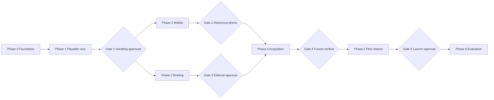
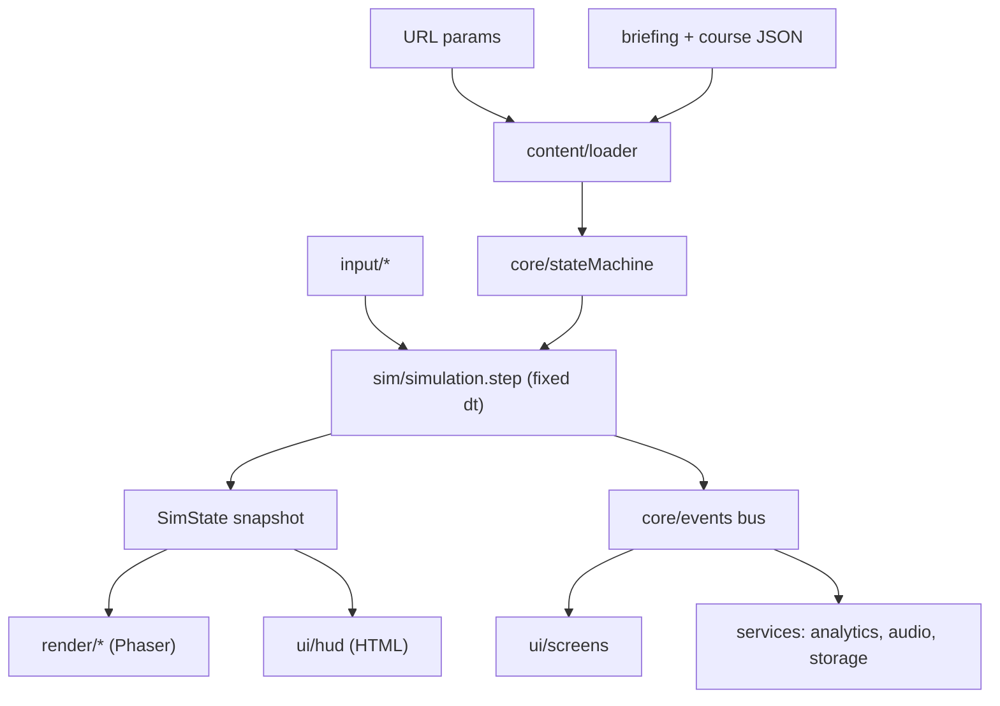

# Candlestick Coaster MVP — Implementation Plan (Index)

**Source of truth:** [PRD-candlestick-coaster-mvp.md](../../PRD-candlestick-coaster-mvp.md) (v1.0, Oct 31 2026)
**Plan version:** 1.0 · **Status:** Draft for owner review
**Supersedes:** the Playground prompt runbook in `candlestick_coaster_project_bible_playground_handoff_spec.md` (ghosts, multiplayer, gamepad, haptics, "Portfolio Value" scoring, and VIX multiplier are **out of MVP scope** per PRD §4 and §9.5).

---

## 1. How this plan is organized

The plan is split into one file per phase so a coding session never has to load the whole plan.

| File | Phase | PRD milestone | Tasks |
| --- | --- | --- | --- |
| [phase-0-foundation.md](phase-0-foundation.md) | 0 · Foundation | (pre-M1) | P0.1 – P0.5 |
| [phase-1-playable-core.md](phase-1-playable-core.md) | 1 · Playable core | M1 | P1.1 – P1.12 |
| [phase-2-mobile.md](phase-2-mobile.md) | 2 · Mobile experience | M2 | P2.1 – P2.5 |
| [phase-3-playable-briefing.md](phase-3-playable-briefing.md) | 3 · Playable briefing | M3 | P3.1 – P3.9 |
| [phase-4-acquisition.md](phase-4-acquisition.md) | 4 · Acquisition layer | M4 | P4.1 – P4.6 |
| [phase-5-pilot-release.md](phase-5-pilot-release.md) | 5 · Pilot release | M5 | P5.1 – P5.8 |
| [phase-6-evaluation.md](phase-6-evaluation.md) | 6 · Evaluation | M6 | P6.1 – P6.3 |



> Phases 2 and 3 can run in parallel after Gate 1 (they touch different folders: `src/input`, `src/ui/layout` vs. `src/content`, `src/ui/screens`). Run them in separate sessions/branches; merge one before starting the other's final task.

---

## 2. Context-window and token budget rules (mandatory)

Every task in this plan is sized so a single AI coding session can complete it **with room to spare** for reasoning, tool output, test logs, and one or two fix iterations.

### 2.1 Budget per task

| Budget item | Size S | Size M | Hard ceiling (split the task if exceeded) |
| --- | --- | --- | --- |
| Context loaded up front (docs + source files read) | ≤ 15K tokens | ≤ 30K tokens | 45K tokens |
| Files created or modified | ≤ 3 | ≤ 6 | 8 |
| Net lines of code written (incl. tests) | ≤ 150 | ≤ 400 | 500 |
| Expected session length | 1 sitting | 1 sitting | — |

There are **no size L tasks**. If a task grows beyond the ceiling during work, stop, commit what passes, and record a follow-up `PX.Ya` / `PX.Yb` split in `docs/PROGRESS.md`.

Rough estimation aids: 1 line of TS ≈ 10–12 tokens; 1 KB of markdown ≈ 250 tokens; the full PRD ≈ 8.5K tokens; this README ≈ 3K tokens; one phase file ≈ 1–4.5K tokens (a single task card ≈ 300–500 tokens).

### 2.2 Structural rules that keep context small

1. **Read only what the task card lists.** Each card has a `Read:` line naming PRD sections and files. Do not open the full PRD or other phase files unless the card says so.
2. **Source files stay ≤ 300 lines.** Split modules before they exceed this so any file can be loaded whole.
3. **Contracts first.** `src/core/types.ts` and `src/config/tuning.ts` are the compact "interface layer." Tasks read these instead of reading implementation files of other modules.
4. **Pure simulation, thin renderer.** All gameplay rules live in framework-free TypeScript under `src/sim/` (unit-testable, no Phaser import). Phaser code in `src/render/` only draws state. A session working on rules never needs Phaser context, and vice versa.
5. **Living architecture map.** `docs/CONTEXT.md` (≤ 150 lines) lists every module, its public exports, and ownership. Update it whenever a public export changes. It replaces reading the codebase.
6. **Progress log, not memory.** `docs/PROGRESS.md` records task status, decisions, deviations, and tuning values found. New sessions read the last ~30 lines, not the transcript of earlier sessions.
7. **Summarize tool output.** Run tests with focused filters (`npm test -- <name>`); avoid dumping full build logs into context.

### 2.3 Session protocol (every task)

**Start (≈ 3–5K tokens):**
1. Read this README §2–§4 (skip the rest).
2. Read `docs/CONTEXT.md` and the tail of `docs/PROGRESS.md`.
3. Read the single task card from the relevant phase file, then the files on its `Read:` line.

**Work:** implement → write/adjust tests named in the card → run `npm run check` (typecheck + lint + unit tests).

**End:**
1. All acceptance boxes for the card are satisfied or explicitly deferred with a reason.
2. Append a ≤ 10-line entry to `docs/PROGRESS.md` (task ID, result, files, follow-ups, any tuning numbers).
3. Update `docs/CONTEXT.md` if a public export, file, or folder changed.
4. One commit: `feat(P1.3): lane transitions` (or `fix`/`chore`/`docs`).

### 2.4 Task card format

```
### PX.Y — Title                                   [Size S|M]
Goal · PRD refs · Depends on
Read:     exact files / PRD sections to load
Touch:    files to create (+) or modify (~)
Steps:    numbered, implementation-level
Accept:   checklist mapped to PRD acceptance criteria
Verify:   commands and/or manual check
Out:      explicitly not in this task
```

---

## 3. Target architecture (summary)

Full detail and current state live in `docs/CONTEXT.md` (created in P0.2).

```
src/
  main.ts                 bootstrap: content → UI shell → Phaser game
  config/tuning.ts        all physics/scoring/timing constants + versions
  core/                   types.ts, stateMachine.ts, runClock.ts, events.ts
  sim/                    PURE: track.ts, kart.ts, lanes.ts, boost.ts,
                          objects.ts, scoring.ts, chapters.ts, simulation.ts
  input/                  inputState.ts, keyboard.ts, touch.ts
  render/                 Phaser: GameScene.ts, trackView.ts, kartView.ts,
                          objectView.ts, effects.ts, camera.ts
  ui/                     HTML/CSS: dom.ts, hud.ts, layout.ts,
                          screens/{intro,pause,results,briefing,fallback}.ts
  content/                schema.ts, loader.ts, briefings/*.json, courses/*.json
  services/               storage.ts, attribution.ts, share.ts,
                          analytics/*.ts, audio.ts
scripts/                  validate-content.ts, check-fairness.ts, report.ts
tests/                    unit (Vitest) mirrors src/; e2e/ (Playwright, Phase 4+)
docs/                     CONTEXT.md, PROGRESS.md, AUTHORING.md, implementation-plan/
```



**Stack defaults (PRD §15; confirm versions at P0.1):** TypeScript (strict), Vite, Phaser (current stable), Vitest, ESLint + Prettier, Zod (or hand-rolled validator if bundle size matters), Playwright for e2e smoke (Phase 4+). No backend, no runtime network dependency to complete a run.

---

## 4. Global conventions

- **Determinism:** the course is hand-authored (no runtime randomness). Tests drive `simulation.step` with scripted input fixtures at a fixed `dt`.
- **Fixed step:** simulation `dt = 1/120 s`, render-frame clamp 0.25 s, accumulator pattern (P0.3).
- **Units:** world units (wu) along x; speed in wu/s; time in seconds of *active* simulation.
- **No financial framing in scoring:** no `$`, P&L, "portfolio," or return language anywhere in UI or code identifiers exposed to users (PRD §9.5, §11).
- **Text is never HTML:** all content strings render via `textContent` (PRD §12, §16).
- **Branches:** `main` is always playable; one branch per task or small task group.
- **Definition of done for code tasks:** `npm run check` passes, card acceptance met, PROGRESS/CONTEXT updated, committed.

---

## 5. Owner decisions → when they block

PRD §22 items do not block prototyping. They block the tasks below.

| # | Decision (PRD §22) | Needed by | Status / Decision |
| --- | --- | --- | --- |
| D1 | Brand name, logo, colors, public title | P5.2 | **Resolved:** Title: "Candlestick Coaster"; Brand Palette: `#000000` (Black), `#14213D` (Prussian Blue), `#FCA311` (Orange), `#E5E5E5` (Alabaster Grey), `#FFFFFF` (White) |
| D2 | Primary CTA URL + qualified-acquisition definition | P3.3 (draft), P5.8 (final) | **Resolved:** CTA URL: `https://predictourney.site/waitlist`; Goal: waitlist sign-up |
| D3 | First-briefing facts, sources, cutoff, hypothetical ending | Gate 3 | Draft content prepared by agent; owner reviews and approves before launch |
| D4 | Hosting + custom domain | P5.6 | Recommended: GitHub Pages, Cloudflare Pages, or Vercel (free static tier) |
| D5 | Analytics service + consent behavior | P4.5 | Recommended: Plausible / Cloudflare Web Analytics / GA4 (or none/console for MVP) |
| D6 | Reference phones + usability testers | Gate 2, P5.8 | Your own smartphone (iOS/Android) + 3–5 friends/followers to test the link |
| D7 | Campaign conversion baseline + acceptable cost | P6.3 | Optional benchmark (how many signups/clicks you usually get from a post) |

---

## 6. Gates (exit criteria from PRD §19)

| Gate | After | Exit criterion | Who |
| --- | --- | --- | --- |
| G1 | P1.12 | Owner completes a run, voluntarily retries; handling approved | Owner |
| G2 | P2.5 | Reference-phone run completes without control or layout failures | Owner + device |
| G3 | P3.9 | Owner approves editorial accuracy, labels, clarity | Owner |
| G4 | P4.6 | End-to-end events and outbound CTA flow verified | Dev + owner |
| G5 | P5.8 | PRD §17 acceptance met; 5 usability sessions done; owner approves release | Owner |
| G6 | P6.3 | Iterate / expand / stop decision recorded | Owner |

---

## 7. Status tracker

Mark `[x]` when the task's PROGRESS entry is written.

- **Phase 0:** [ ] P0.1 [ ] P0.2 [ ] P0.3 [ ] P0.4 [ ] P0.5
- **Phase 1:** [ ] P1.1 [ ] P1.2 [ ] P1.3 [ ] P1.4 [ ] P1.5 [ ] P1.6 [ ] P1.7 [ ] P1.8 [ ] P1.9 [ ] P1.10 [ ] P1.11 [ ] P1.12 · [ ] **G1**
- **Phase 2:** [ ] P2.1 [ ] P2.2 [ ] P2.3 [ ] P2.4 [ ] P2.5 · [ ] **G2**
- **Phase 3:** [ ] P3.1 [ ] P3.2 [ ] P3.3 [ ] P3.4 [ ] P3.5 [ ] P3.6 [ ] P3.7 [ ] P3.8 [ ] P3.9 · [ ] **G3**
- **Phase 4:** [ ] P4.1 [ ] P4.2 [ ] P4.3 [ ] P4.4 [ ] P4.5 [ ] P4.6 · [ ] **G4**
- **Phase 5:** [ ] P5.1 [ ] P5.2 [ ] P5.3 [ ] P5.4 [ ] P5.5 [ ] P5.6 [ ] P5.7 [ ] P5.8 · [ ] **G5**
- **Phase 6:** [ ] P6.1 [ ] P6.2 [ ] P6.3 · [ ] **G6**

**Totals:** 48 tasks (15 S, 33 M) + 6 gates.

---

## 8. PRD acceptance traceability (§17)

| PRD §17 area | Implemented in | Verified in |
| --- | --- | --- |
| Entry | P3.2, P3.4 | P4.6, P5.8 |
| Run (60 s active, pause-safe) | P0.3, P1.9 | P1.9 tests, P2.3 |
| Movement | P1.1, P1.2 | P1.2 tests, P1.11 |
| Rails | P1.3 | P1.3 tests, G1 |
| Controls | P1.5, P2.2 | P2.5 |
| Boost/brake | P1.4, P1.11 | P1.4 tests, G1 |
| Objects | P1.7 | P1.7 tests |
| Fairness | P1.11, P3.8 | `check-fairness` script, G1, G3 |
| Briefing | P3.5, P3.6, P3.7 | G3 |
| Integrity | P3.1, P3.3, P3.6 | validator, G3 |
| Results | P1.10, P3.6 | P4.6 |
| Restart | P1.9 | P1.9 tests |
| Persistence | P4.1 | P4.1 tests |
| Attribution | P4.2 | P4.2 tests, P4.6 |
| Analytics | P4.4, P4.5 | P4.6 |
| Accessibility | P3.4–P3.7, P5.3 | P5.3 audit |
| Mobile | P2.1–P2.4 | G2 |
| Failure | P2.3, P5.4 | P5.4 tests, P5.8 |
| Publishing | P5.6 | P5.8 |
